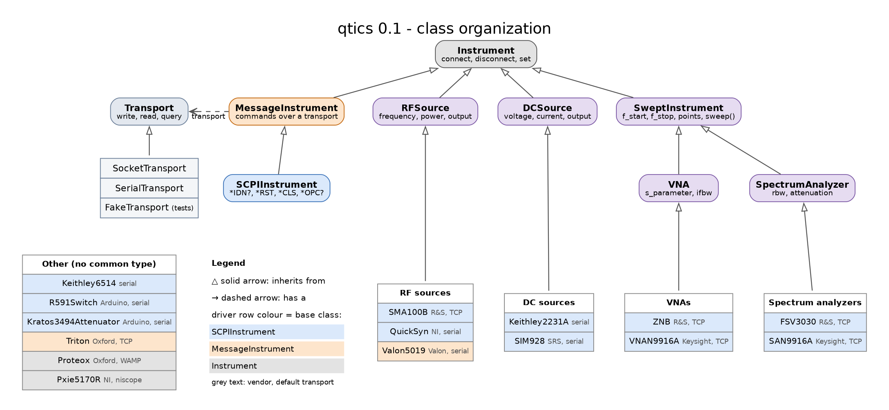

Migrating to qtics 0.1
======================

Version 0.1 reorganizes the package by vendor and gives instruments of the same
type a common interface. ``from qtics import <Class>`` keeps working for every
driver (old class names are kept as aliases), but deep module paths changed and
several attributes were renamed.

qtics now contains only instrument drivers: the experiment classes
(``qtics.experiment``: ``Experiment``, ``MonitorExperiment``, ``BaseExperiment``)
and the ``experiments`` dependency group (h5py, matplotlib) were removed.

Connections
-----------

Drivers no longer inherit from ``NetworkInst``/``SerialInst``: they hold a
transport (:mod:`qtics.transport`). Pass an address and the driver builds its
default transport, or pass a transport explicitly:

.. code-block:: python

   from qtics import ZNB, Valon5019
   from qtics.transport import SerialTransport, FakeTransport

   vna = ZNB("192.168.0.4")                   # socket, port 5025
   synth = Valon5019("/dev/ttyUSB0")           # serial, driver defaults
   synth = Valon5019("/dev/ttyUSB0", delay=0.5)  # override a transport option
   test_vna = ZNB(FakeTransport(default="0"))  # no hardware, for tests

   with ZNB("192.168.0.4") as vna:             # connect/disconnect
       f, s21 = vna.snapshot()

- The constructor signature is ``(transport_or_address, name=..., **options)``:
  ``name`` is now the second argument (it was the last one). ``Pxie5170R`` takes
  ``(address, name)`` (it was ``(name, address)``).
- The old ``sleep`` option is the transport ``delay``. The ``sleep``, ``socket``
  and ``serial`` attributes of the instruments are gone: use ``inst.transport``
  (e.g. ``inst.transport.delay``, ``inst.transport.socket``).
- The default ``name`` is now the class name (e.g. ``"ZNB"`` instead of
  ``"RSZNB"``, ``"Valon5019"`` instead of ``"VALON"``, ``"VNAN9916A"`` instead of
  ``"N9916A"``).
- Writing to a disconnected instrument raises ``ConnectionError`` (network
  instruments used to log a warning and ignore the command).
- Network addresses are no longer validated as IPs: hostnames are accepted.
- ``Triton`` has no default IP address anymore.
- Instruments are no longer disconnected in ``__del__``: use ``disconnect()`` or a
  ``with`` block. Teardown commands (e.g. Keithley ``SYST:LOC``) are sent only
  by ``disconnect()``.
- ``reset()`` sends ``*RST`` only to SCPI instruments; on the others (e.g.
  ``Triton``) it only restores the default values.

Module paths
------------

================================================== ===========================================
old                                                new
================================================== ===========================================
``qtics.instruments.instrument``                   ``qtics.instruments.base``
``qtics.instruments.network.NA_N9916A``            ``qtics.instruments.keysight.n9916a``
``qtics.instruments.network.RS_ZNB``               ``qtics.instruments.rohde_schwarz.znb``
``qtics.instruments.network.RS_FSV3030``           ``qtics.instruments.rohde_schwarz.fsv3030``
``qtics.instruments.network.RS_SMA100B``           ``qtics.instruments.rohde_schwarz.sma100b``
``qtics.instruments.network.triton_ctrl``          ``qtics.instruments.oxford.triton``
``qtics.instruments.network.proteox``              ``qtics.instruments.oxford.proteox``
``qtics.instruments.network.utils.query_data``     ``qtics.instruments.utils.query_binblock``
``qtics.instruments.serial.keithley2231a``         ``qtics.instruments.keithley.k2231a``
``qtics.instruments.serial.keithley6514``          ``qtics.instruments.keithley.k6514``
``qtics.instruments.serial.quick_synth``           ``qtics.instruments.ni.quicksyn``
``qtics.instruments.serial.valon_5019``            ``qtics.instruments.valon.v5019``
``qtics.instruments.serial.voltage_source_SIM928`` ``qtics.instruments.srs.sim928``
``qtics.instruments.serial.rf_switch_R591722600``  ``qtics.instruments.arduino.r591_switch``
``qtics.instruments.serial.rf_attenuator_3494_64`` ``qtics.instruments.arduino.kratos_3494``
``qtics.instruments.niscope.pxie_5170r``           ``qtics.instruments.ni.pxie5170r``
================================================== ===========================================

Class names
-----------

Old names still work from ``qtics``: ``RSZNB`` -> ``ZNB``, ``VALON5019`` ->
``Valon5019``, ``FSQS`` -> ``QuickSyn``, ``Pxie570R`` -> ``Pxie5170R``,
``Switch_R591``/``Radiall_R591722600`` -> ``R591Switch``,
``Attenuator_3494_64``/``Kratos_349464`` -> ``Kratos3494Attenuator``,
``SRS_SIM928`` -> ``SIM928``, ``Keithley_6514`` -> ``Keithley6514``,
``Keithley_2231A`` -> ``Keithley2231A``. The asynchronous Proteox class is now
``AsyncProteox``; ``Proteox`` is a new synchronous wrapper.

Attributes
----------

Units are SI (Hz, s, V, A), powers in dBm; on/off states are ``bool`` properties.

Swept analyzers (``VNAN9916A``, ``SAN9916A``, ``ZNB``, ``FSV3030``):

- ``f_min``/``f_max`` -> ``f_start``/``f_stop``; ``sweep_points`` -> ``points``
- ``average`` -> ``averages``; ``IFBW`` -> ``ifbw``; ``s_par`` -> ``s_parameter``
- ``single_sweep()`` -> ``sweep()``; ``continuous`` is a bool property
- ``read_trace_data()`` no longer sweeps: use ``sweep()`` or ``snapshot()``
- ``query_data()`` methods -> ``qtics.instruments.utils.query_binblock(inst, cmd, datatype)``
- ``SAN9916A``: ``res_bandwidth`` -> ``rbw``, ``auto_res_bandwidth`` -> ``auto_rbw``
- ``ZNB``: ``t_min``/``t_max`` -> ``t_start``/``t_stop``; ``time_domain`` and
  ``harmonic_grid`` return bool

RF sources:

- ``SMA100B``: ``f_fixed`` -> ``frequency``, ``p_fixed`` -> ``power``,
  ``rf_status``/``on()``/``off()``/``is_on()`` -> ``output``,
  ``f_min``/``f_max`` -> ``f_start``/``f_stop``, ``p_min``/``p_max`` ->
  ``p_start``/``p_stop``. The power unit is set to dBm when connecting.
  Frequency limits follow the multiplier and offset (``rf_min``/``rf_max`` set the
  hardware range); ``f_stop`` is clipped like the other frequencies instead of
  raising.
- ``Valon5019``: ``f_fixed`` -> ``frequency``, ``p_fixed`` -> ``power``,
  ``rf_status`` -> ``output``, ``sweep_start``/``sweep_stop``/``sweep_step`` ->
  ``f_start``/``f_stop``/``f_step``, ``freq_offset`` -> ``f_offset``,
  ``freq_step`` -> ``f_step_cw``; ``output`` and ``power_pdn`` take bool.
- ``QuickSyn``: ``freq`` -> ``frequency``, ``output_on`` -> ``output``.

Triton:

- ``mixing_chamber_tset`` is set in K, like it is read (the setter took mK).
- ``heater_range`` is in A (it was read in mA).
- ``get_action`` reports "Circulating" only below 2 K (the threshold compared K
  with 2000).

DC sources and others:

- ``Keithley2231A``: new ``output`` property.
- ``SIM928``: ``output_on()``/``output_off()``/``on()``/``off()``/``is_on()`` ->
  ``output``; ``voltage`` returns float.
- ``R591Switch``: ``pulse_lenght`` -> ``pulse_length`` (int).
- ``Kratos3494Attenuator``: ``attenuation`` returns float.
